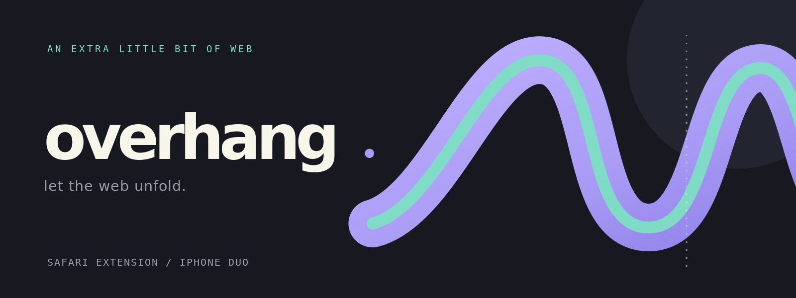

# Overhang



A Safari extension that lays web pages out across the whole front screen of the iPhone Duo.

On the front screen Safari keeps its buttons in an 84-point column on the right and lays pages out beside it: 377
points of the screen's 461 on our Duo (382 of 466 on others). Overhang lays them out the full width. Pictures,
banners and colored bars run under the buttons; lines of text, links and buttons stop beside them; fixed bars, cookie
banners and sign-in dialogs end at the column so their buttons stay reachable.

## Using it

1. Install Overhang and open it. **Open Safari Settings** goes straight to the extension.
2. Turn on **Allow Extension**, then pick how much Safari lets it see:
   - **Ask** (recommended): it runs nowhere until you allow a site. Open the site, tap **•••**, then **Overhang**, and
     choose **Always Allow on This Website**.
   - **Allow**: every page is widened as it opens.

The panel behind **•••** › **Overhang** can widen the page you're on once (handy on a site you haven't allowed),
switch Overhang off for a site, and let text run under the buttons.

It works in portrait and in both landscapes (with the camera on the left Safari moves its column to the left, and
Overhang mirrors everything), with or without Shift Display for a case. It leaves other iPhones, the unfolded Duo,
and pages not laid out for phones (no `width=device-width`) alone.

## Layout

- `App/`: the SwiftUI app with the setup steps.
- `Extension/Resources/content.js`: the page script. Measures the page once per change and writes inline styles it
  can take back.
- `Extension/Resources/popup.*`: the panel in Safari's menu.
- `project.yml`: the XcodeGen spec. The `.xcodeproj` isn't committed.
- `brand/`: icon, wordmark and banner sources, and the brand notes. The App Store icon is `brand/icon.svg` rendered
  square (Apple rounds the corners itself).

## Building

Needs Xcode 27.1 or later (an app built against an older SDK runs letterboxed on the Duo) and XcodeGen.

```sh
xcodegen generate
open Overhang.xcodeproj
```

Set your team on both targets and run on a Duo. Safari in the simulator doesn't lay the front screen out the same way
as the phone.

CI (`.github/workflows`):

- `ci.yml` builds unsigned on every push, on GitHub's `xcode-27` image.
- `apple-setup.yml` registers the bundle ids and makes the App Store profiles (run once, then store them as
  `DIST_PROFILE_BASE64` and `DIST_PROFILE_EXTENSION_BASE64`).
- `testflight.yml` builds, signs, uploads and hands the build to the internal testers. The build number is the run
  number, and the manifest version follows it because Safari only reloads an extension's scripts when that changes.

## Credits

The layout code is adapted from [Brim](https://github.com/AVGVSTVS96/brim) (MIT), which in turn credits
[Splay](https://github.com/aztechead/splay) and [DuoWide](https://github.com/hyungchulc/duowide) for working out how
Safari behaves on this screen.

## Privacy

Overhang collects nothing and makes no network requests: [docs/privacy.md](docs/privacy.md).

## License

MIT, see [LICENSE](LICENSE).
